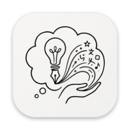

  

<h1 align="center">OneMemory</h1>

  <b>Remembers what you've seen, and finishes what you type.</b> 
  A Mac menu bar app that keeps a searchable memory of the text on your screen and suggests the
  rest of your sentence in almost any app. On your Mac, with no account.

  
  
  
  
  

  

  <a href="https://github.com/jhasubhash/onememory-releases/releases/latest"><b>Download for Mac</b></a>

OneMemory sits in your menu bar and quietly reads the window you're working in: messages, pages,
tickets, documents. It keeps that text in a private, searchable history on your Mac, and uses it
to help you type: grey suggestions appear after the caret, and Tab accepts them.

---

## 🔎 Find anything you've seen

Press **⌃⌥M** and search everything that's been on your screen.

- **Where and when:** each result shows the app, the window and how long ago you saw it, with the
  matching words highlighted and the full text beside it.
- **Back in one key:** press Return to reopen the page or app it came from, or ⌘Return to copy it.
- **Filter by app:** `app:slack deploy failed` searches only what you saw in Slack.
- **Text, not screenshots:** OneMemory reads what apps share with macOS accessibility. For apps
  that don't, it reads the screen in memory and never saves the image.

## ⌨️ Autocomplete in almost every app

- **Grey suggestions after the caret** in Mail, Notes, Messages, Slack, browsers and more. Press
  **Tab** to accept, **Esc** to dismiss, or keep typing.
- **Fast:** the built-in model answers in well under a tenth of a second on Apple silicon, and
  finishes half-typed words.
- **Knows your details:** when you type "my address is" or "my mobile is", OneMemory looks it up
  in what you've seen and can finish it for you.
- **Stays out of the way** in terminals and code editors, and never reads password fields.

## 🧠 Your choice of model

| | |
| --- | --- |
| 💻 **Built-in** | Download the recommended model in Settings and run it on this Mac (llama.cpp on the GPU) |
| 🦙 **Local servers** | Ollama, LM Studio, or any OpenAI-compatible server such as llama-server or vLLM |
| ☁️ **Cloud APIs** | Anthropic or OpenAI, with your own API key, stored in the Keychain |
| 🛠️ **CLIs** | Claude CLI, using the sign-in it already has |

Pick the model and, where the provider supports it, the effort level.

## 🔒 Private by design

- **On your Mac:** capture, search and the built-in model all run locally. Nothing is sent
  anywhere unless you choose a cloud provider, and your memory is only shared with one if you
  turn that on.
- **Secrets stay out:** tokens, API keys, private keys and card numbers are removed before
  anything is saved.
- **You're in control:** pause capture, exclude apps (password managers are excluded already),
  skip private browser windows, forget the last hour or day, and choose how long history is kept.
- **Less noise:** menus, sidebars and other interface text that repeat across windows are
  recognised and left out.

---

## Install

1. Download `OneMemory-x.y.z.dmg` from **[Releases](https://github.com/jhasubhash/onememory-releases/releases/latest)**.
2. Open it and drag **OneMemory** to **Applications**.
3. Open OneMemory and grant **Accessibility** in System Settings › Privacy & Security. It's needed
   to read the window you're using and to show suggestions. **Screen Recording** is optional.
4. For the built-in model, open **Settings › Autocomplete** and download the recommended model
   (2.5 GB), or pick another provider.

Builds are signed with Developer ID and notarized by Apple. Requires macOS 26 or later on Apple
silicon.

## Support

If OneMemory saves you a search or a few keystrokes, you can
[buy me a coffee](https://www.buymeacoffee.com/subhashjha) ☕

---

This repository hosts the downloads. Release notes are on each
[release](https://github.com/jhasubhash/onememory-releases/releases).
